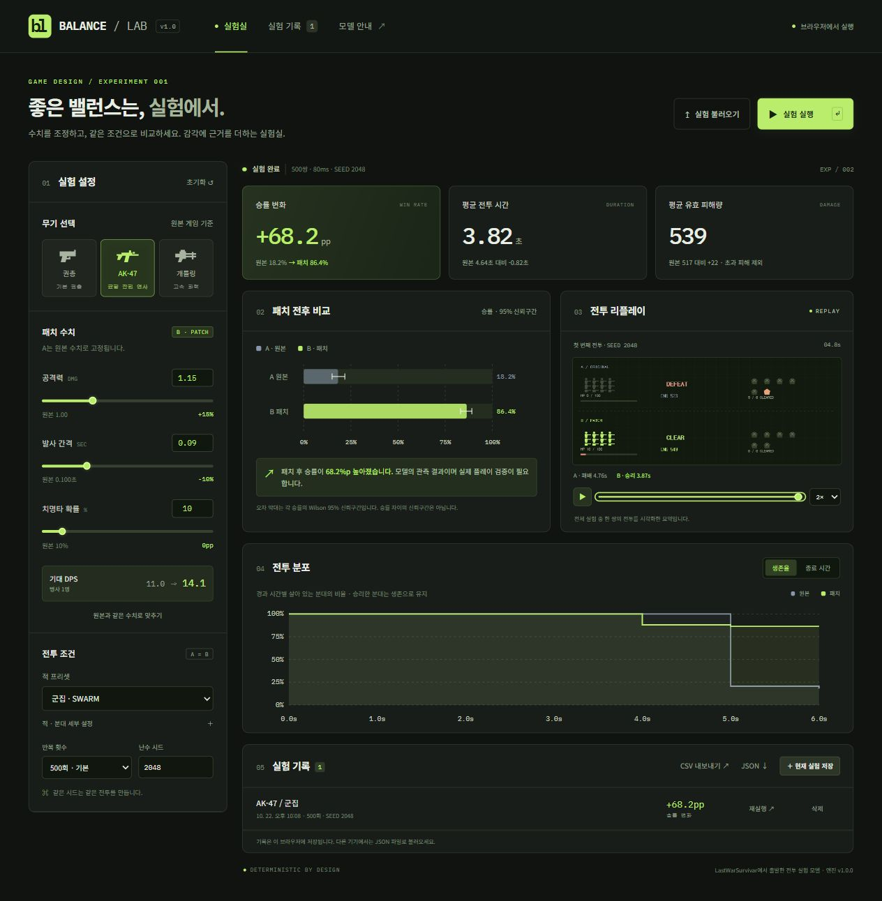

# Balance Lab · 게임 밸런스 실험실

[라이브 데모](https://juhyeonmoon10.github.io/balance-lab/) · [자동 검사](https://github.com/juhyeonmoon10/balance-lab/actions/workflows/ci.yml) · [모델 설명](docs/MODEL.md)

무기 수치를 조정했을 때 전투 결과가 얼마나 달라지는지 비교하는 브라우저 실험 도구입니다. 한 번의 운 좋은 플레이로 결론을 내리지 않도록, 기준안과 패치안을 같은 시드로 반복 실행하고 승률과 불확실성을 함께 살펴봅니다.

기존 [LastWarSurvivar](https://github.com/juhyeonmoon10/LastWarSurvivar)의 무기 수치에서 출발해 만든 별도 시뮬레이터입니다. 원본 게임 전체를 이식하거나 실제 플레이 결과를 재현하는 도구는 아닙니다. 분대와 적의 교전을 단순화한 모델에서 수치 변경의 영향을 비교합니다.



전투 규칙과 통계 해석은 [실험 모델 문서](docs/MODEL.md)에 정리했습니다.

## 할 수 있는 일

- 무기 3종과 적 3종을 선택하고 패치 수치·교전 조건을 조정합니다. 기준안의 무기 수치는 원본 값으로 고정됩니다.
- 공통 시드를 사용하는 Monte Carlo 반복 실험으로 결과를 다시 확인합니다.
- 승률과 Wilson 방식의 95% 신뢰구간을 함께 표시합니다.
- 개별 전투 리플레이로 결과가 나온 과정을 살펴봅니다.
- 설정을 브라우저에 저장하고 JSON 파일로 내보내거나 가져옵니다.
- 실험 결과를 CSV 파일로 내려받아 따로 분석합니다.

설정과 결과는 현재 브라우저에서 처리합니다. 별도 계정, 서버 데이터베이스, 외부 JavaScript 라이브러리를 요구하지 않습니다. 브라우저 저장소를 지우기 전 보관할 설정은 JSON으로 내보내세요.

## 빠르게 실행하기

Node.js 22 이상을 준비한 뒤 저장소 폴더에서 실행합니다. 외부 패키지가 없으므로 `npm install` 단계는 필요하지 않습니다.

```sh
npm run dev
```

[http://127.0.0.1:4173](http://127.0.0.1:4173)을 엽니다. 서버는 이 컴퓨터의 루프백 주소에만 바인딩하며 `dist/` 안의 파일만 제공합니다. 종료하려면 터미널에서 `Ctrl+C`를 누릅니다.

브라우저 ES 모듈을 사용하므로 HTML 파일을 직접 더블클릭하는 대신 위 서버로 실행하세요. 포트가 사용 중이면 `PORT` 환경 변수로 바꿀 수 있습니다.

```powershell
$env:PORT = '4174'
npm run dev
```

## 실험 순서

1. 프리셋을 선택하고 기준안의 분대·무기·적 설정을 확인합니다.
2. 패치안에서 비교할 수치를 바꿉니다. 처음에는 한 변수만 바꾸면 결과 해석이 쉽습니다.
3. 시드와 반복 횟수를 정해 비교 실험을 실행합니다.
4. 승률의 차이와 각 안의 신뢰구간을 읽고 개별 전투 리플레이를 확인합니다.
5. 재현에 필요한 설정은 JSON, 결과 표는 CSV로 내보냅니다.

같은 설정과 시드를 사용하면 같은 결과를 재현할 수 있습니다. 같은 시드는 두 안을 비교하기 위한 공통 출발점이며, 변경된 전투 흐름의 모든 난수 이벤트가 일대일로 일치한다는 뜻은 아닙니다.

## 재현 가능한 예시

[예시 실험 JSON](docs/example-experiment.json)을 내려받아 화면의 **실험 불러오기**로 선택하면 기본 설정으로 다시 실행할 수 있습니다. 파일에는 설정과 요약 결과를 저장하며, 앱은 불러온 설정을 검증하고 결과를 새로 계산합니다.

기본 AK-47·Swarm 설정, **500회·시드 2048**에서 관측한 결과입니다. 패치안은 공격력 `1 → 1.15`, 발사 간격 `0.10초 → 0.09초`이며 치명타 확률은 10%로 같습니다.

| 조건 | 관측 승률 |
| --- | ---: |
| 기준안 | 18.2% |
| 패치안 | 86.4% |
| 차이 | +68.2%p |

이 수치는 위 설정의 추상 전투 모델에서 얻은 관측값입니다. 실제 게임의 승률 개선이나 재미 향상을 측정한 성과가 아닙니다. 다른 적·시드·분대 조건에서도 비교하면서 패치의 영향을 해석할 수 있습니다.

## 원본 수치와 모델의 범위

원본 프로젝트에서 가져온 출발 수치는 다음과 같습니다. 이 값이 현재 원본 게임의 최종 밸런스라는 뜻은 아닙니다.

| 무기 | 기본 피해량 | 발사 간격 |
| --- | ---: | ---: |
| Pistol | 1 | 0.35초 |
| AK | 1 | 0.10초 |
| Gatling | 2 | 0.05초 |

공통 치명타 확률은 10%, 치명타 피해 배율은 2배입니다. 그 밖의 분대·적 구성과 전투 진행 규칙은 실험을 위한 추상화입니다.

- 분대는 공동 체력을 사용하며, 체력이 줄어도 사격하는 병력 수는 고정됩니다.
- 한 번에 적 하나와 교전합니다. 적을 쓰러뜨리면 다음 적이 즉시 등장하고, 초과 피해는 이월하지 않습니다.
- 적 체력은 기준의 ±15%, 적 공격 피해는 ±10% 범위에서 달라집니다. 적의 첫 공격 시점도 변동합니다.
- 같은 시점의 사격과 적 공격은 분대 사격부터 처리합니다. 제한 시간 내 적을 모두 처치하지 못하면 승리로 계산하지 않습니다.
- 평균 전투 시간은 승리·패배·시간 초과를 모두 포함합니다. 짧아졌다는 사실만으로 개선이라고 판단하지 않습니다.

원본의 이동, 조준, 투사체 물리, 충돌, 지형, 플레이어의 조작 숙련도를 그대로 시뮬레이션하지 않습니다.

Wilson 95% 신뢰구간은 반복 실험에서 관측한 승률의 통계적 불확실성을 보여줍니다. 모델 자체의 정확도를 보증하거나, 두 안의 차이에 대한 별도 유의성 검정을 대신하지는 않습니다. 원본 게임의 실제 밸런스를 결정하려면 플레이 테스트와 함께 해석해야 합니다.

## 설계에서 고려한 점

- **계산과 화면 분리:** DOM에 의존하지 않는 순수 전투 엔진을 Node에서 테스트하고, 반복 계산은 Web Worker에서 실행해 UI와 분리했습니다.
- **짝지은 난수:** 두 안에 시행별 공통 시드를 쓰고 적 체력·공격·치명타의 난수 채널을 구분했습니다. 수치 변경으로 전투 흐름이 달라져도 대응하는 순번의 추첨값을 공유합니다.
- **승률 경계 처리:** 0승과 전승에서도 불확실성이 사라진 것처럼 보이지 않도록 Wilson 구간을 사용했습니다. 두 승률의 차이에 대한 검정과는 구분합니다.
- **작게 저장하고 다시 계산:** JSON에는 설정·버전·요약 결과만 담고 큰 리플레이 사건 목록은 제외합니다. 불러올 때 설정을 검증하고 결과와 리플레이를 재생성합니다.

## 코드 구성

```text
dist/
  index.html          화면 구조
  app.js              설정·실험·결과 UI
  worker.js           UI와 분리한 반복 실험 실행
  style.css           화면 스타일
  lib/
    engine.js         전투 시뮬레이션과 통계
    presets.js        초기 설정과 프리셋
    experiments.js    로컬 기록·JSON 입출력·CSV 변환
docs/
  MODEL.md            전투 규칙과 통계 해석
  example-experiment.json  불러와 재실행할 예시 실험
  screenshot.jpg      앱 화면
scripts/
  serve.mjs           개발용 정적 파일 서버
tests/
  *.test.js           Node 내장 테스트 러너로 실행하는 테스트
.github/workflows/
  ci.yml              테스트와 JavaScript 문법 검사
  pages.yml           수동 GitHub Pages 배포
```

`dist/`는 빌드 산출물을 복사해 두는 폴더가 아니라 직접 편집하고 Git에 포함하는 앱 소스입니다. 번들러와 빌드 과정이 없습니다.

## 검증

```sh
npm test
npm run check
```

`npm test`는 Node 내장 테스트 러너를, `npm run check`는 앱·Worker·엔진 모듈의 문법 검사를 실행합니다. CI는 Node.js 22에서 테스트와 모듈 문법 검사를 실행하도록 구성했습니다.

2026-10-22 로컬 검증 범위:

- Node 테스트 **24개 통과**, JavaScript 문법 검사 통과.
- 데스크톱과 **390px 너비**의 브라우저 화면에서 앱 확인.
- 기준안과 패치안을 동일 수치로 설정했을 때 결과 일치 확인.
- 잘못된 숫자 입력 처리, 실험 저장 후 새로고침·복원 확인.
- JSON 다운로드 → 불러오기 → 실험 재실행 흐름 확인.
- 리플레이와 생존율·종료 시간 분포 탭 동작 확인.

이 기록은 위 범위의 로컬 검증 결과입니다. GitHub Actions의 실행 결과는 저장소에 올린 뒤 해당 커밋의 실행 기록에서 확인할 수 있습니다.

## GitHub Pages에 올리기

로컬 실행만 할 때는 이 설정이 필요하지 않습니다.

1. 이 폴더의 파일을 GitHub 저장소에 올립니다.
2. 저장소 **Settings → Pages → Build and deployment → Source**를 **GitHub Actions**로 설정합니다.
3. **Actions → Publish to GitHub Pages → Run workflow**를 실행합니다.
4. 성공한 배포 작업이 표시하는 주소에서 앱을 엽니다.

Pages 워크플로는 수동 실행만 지원합니다. 일반적인 push는 테스트를 실행하며 배포를 시작하지 않습니다. 배포 대상은 `dist/` 폴더입니다.

## 제작 및 설명

이 프로젝트 초안은 AI 코딩 도구의 도움을 받아 작성되었습니다. 포트폴리오에서는 직접 검토한 코드, 선택한 모델 가정, 수행한 실험과 그 해석을 구분해서 설명하는 것이 좋습니다. 실제 사용자 수, 적용 성과, 성능 개선 수치는 측정한 근거가 있을 때 추가하세요.
